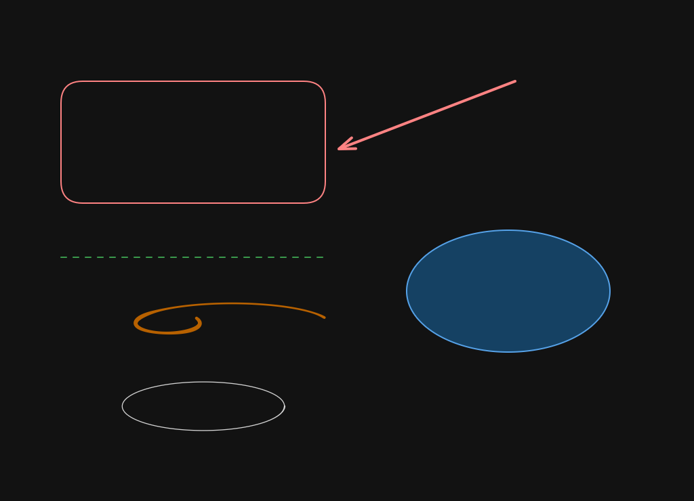
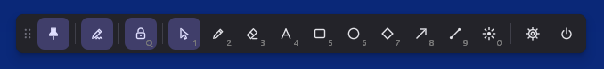
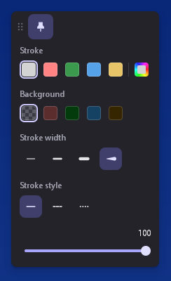

# PenPane

<a href="https://github.com/AlexDeveloperUwU#ai-usage"></a>

This project was fully generated with AI: I gave the orders and prompts, and I reviewed the result.

PenPane is a small native screen-annotation overlay for Windows 10 and 11. It draws over whatever is on screen for presentations, demos and teaching, or turns into a dark whiteboard. It is built for pen tablets: the two buttons of the pen can control every action through global hotkeys, and the drawing feel follows Excalidraw.

It is one executable of about 150 KB, written in C11 against the Win32 API. There is no runtime, no installer and no UI toolkit, and when it is idle it uses no CPU.



## Features

- **Tools:** selection (move, resize, delete), rectangle, ellipse, diamond, arrow (one head or two), line, pen, laser pointer, text and eraser. The starting tool is select, so nothing is drawn by accident. Stroke and background colors, three widths plus pressure, solid, dashed and dotted styles, opacity and unlimited undo and redo.
- **Colors:** five presets, a color picker with a hex field, an optional pastel row and your own colors from the configuration file.
- **Your toolbar:** reorder or hide tools in the settings window; the number keys follow the order.
- **Laser pointer:** a fading trail; short or quick strokes fade tail first, like long ones.
- **Hide, clear, settings:** an eye button hides the drawings without deleting them, the trash asks before clearing, and the gear at the end of the toolbar opens settings with reset buttons.
- **Optional debug log:** a small plain-text log you switch on only when something misbehaves; it costs nothing while off.
- **Desktop and whiteboard modes:** desktop draws on a transparent layer over live content; whiteboard is an opaque dark canvas. Each keeps its own drawing and history.
- **Click-through:** with drawing off the annotations stay visible while mouse, touch and pen input reach the applications below.
- **Pen button gestures:** bind any action to a key or mouse button as a single press, a double press or a long press. Learn mode lets you press the button you want to bind instead of typing its name.
- **Pen pressure:** real pressure is used when the tablet reports it; otherwise stroke width follows speed, using the model measured from Excalidraw.
- **Floating tools:** the toolbar, the properties panel and the undo and redo panel are separate windows that open on click, fold back into a handle when you leave them, and can be pinned open.
- **Two monitors:** choose the screen you draw on and the screen that holds the tools. The tools are excluded from screen capture by default, so an audience watching a shared screen does not see them.
- **Copy or save as PNG:** put the drawing on the clipboard or write it to a file, with transparency in desktop mode.
- **Tiny footprint:** measured on Windows 11 with the real executable (see [docs/measurements.md](docs/measurements.md)):

| Quantity | Value |
|---|---|
| Idle CPU, every state, over 60 s | 0 ms |
| Working set, hidden or drawing off | 0.2 to 0.3 MB |
| Working set while drawing on a 2560x1376 screen | about 16 MB (the drawing surface is 13.8 MB of it) |
| Process start to first visible window | 47.5 ms median |
| Pointer event, handler to present | 0.25 ms on average |

| | |
|---|---|
|  |  |

## Quick start

1. Download `PenPane.exe` and `PenPane.exe.sha256` from the Releases page of the repository and check the file: `(Get-FileHash PenPane.exe).Hash` must match the contents of the checksum file.
2. Run `PenPane.exe`. It lives in the notification area and shows a small toolbar handle. Put the program in a folder you can write to, because it keeps `PenPane.ini` next to the executable.
3. Start it a second time, or click the toolbar handle and then its drawing button, to turn drawing on or off. Right-click the tray icon for modes, screens, remapping, copying as PNG, starting with Windows and quitting.
4. `Ctrl+Alt+Shift+Esc` always quits. If another program owns that combination, PenPane falls back to `Ctrl+Alt+Shift+F12` and tells you.

| Tool | Key |
|---|---|
| Selection | V |
| Rectangle | R |
| Ellipse | O |
| Diamond | D |
| Arrow | A |
| Line | L |
| Pen | P or X |
| Laser | K |
| Text | T |
| Eraser | E |
| Tool by place in the toolbar | 1 to 9, 0 for the tenth |
| Tool lock | Q |
| Undo, redo | Ctrl+Z, Ctrl+Y or Ctrl+Shift+Z |

More in [docs/usage.md](docs/usage.md).

## Pen tablet setup

PenPane does not talk to tablet drivers. It reacts to keys and mouse buttons, so any pen with buttons works:

1. In the driver of your tablet, map the two pen buttons to rarely used keys, for example `F13` and `F14`.
2. Out of the box `F13` single press is undo, `F13` double press toggles drawing, `F14` single press selects the next tool, `F14` double press toggles desktop and whiteboard, and `F14` long press clears.
3. To change a binding, choose Remap buttons in the tray menu, pick an action, and press the button the way you want to use it (single, double or long).

## When something does not work

Turn on "Write a debug log" in the settings (or set `debug_log = true` in `PenPane.ini`). PenPane then writes `PenPane.log` next to the executable: start-up, configuration warnings, mode changes, window failures, display and lock events, tray notices and crashes, one short line each, never pointer movement. The file is capped at 1 MB (the older file is kept as `PenPane.log.1`). Attach it to a bug report; it contains no drawings and no text you typed.

## Configuration

Settings live in a plain-text `PenPane.ini` next to the executable. Every key is optional and the file can be edited by hand and reloaded from the tray menu. See [docs/configuration.md](docs/configuration.md) for every key and the binding syntax.

## Building from source

You need only the llvm-mingw toolchain, which one script installs after verifying its checksum:

```powershell
powershell -NoProfile -ExecutionPolicy Bypass -File scripts\setup-toolchain.ps1
powershell -NoProfile -ExecutionPolicy Bypass -File scripts\build.ps1
powershell -NoProfile -ExecutionPolicy Bypass -File scripts\test.ps1
```

The result is `build\PenPane.exe`. Details, measuring and API documentation are in [docs/building.md](docs/building.md).

## Limitations

- Windows 10 version 2004 or later is needed for the capture exclusion of the tool panels (`WDA_EXCLUDEFROMCAPTURE`); on older versions they are visible in recordings.
- Programs running as administrator, and the secure desktop used by UAC prompts, are protected from normal processes: pen button bindings and mouse triggers may not reach PenPane while such a window has the focus, and it may not be able to draw over them. Run PenPane elevated only if you need this.
- Applications in exclusive full-screen mode (some games and video players) cover every overlay. Borderless full-screen windows work.
- Real pen pressure and multi-monitor setups are not covered by the automated tests; they were not verified on real tablet hardware or on more than one display by the author.
- Only a PNG copy to the clipboard is offered as export. There is no light theme, zoom, pan, image support or collaboration.

## Documentation

Start with [docs/README.md](docs/README.md). Decisions are recorded one per file in [docs/notes](docs/notes/index.md).

## Contributing and security

Read [CONTRIBUTING.md](CONTRIBUTING.md) first. Please follow the [code of conduct](CODE_OF_CONDUCT.md). Report vulnerabilities as described in [SECURITY.md](SECURITY.md).

## Acknowledgements

- [Excalidraw](https://github.com/excalidraw/excalidraw) (MIT) is the model for the look, sizes, shortcuts and drawing behaviour. The measured values are listed in [docs/excalidraw-reference.md](docs/excalidraw-reference.md).
- [perfect-freehand](https://github.com/steveruizok/perfect-freehand) (MIT, by Steve Ruiz) is the stroke algorithm behind the pen's width and smoothing, as described in [note 0040](docs/notes/0040-pen-width-model-follows-measured-perfect-freehand.md).
- [OpenBoard](https://openboard.ch) (GPL-3.0-only, by the Geneva education department) gave the idea of desktop mode: a transparent layer over the screen that you can draw on and interact with.

PenPane reuses only the constants and formulas of Excalidraw and perfect-freehand, and only the idea from OpenBoard. It does not use their code or technology.

## License

PenPane is free software: you can redistribute it and modify it under the terms of the GNU General Public License as published by the Free Software Foundation, either version 3 of the License, or (at your option) any later version. It is distributed in the hope that it will be useful, but without any warranty. See [LICENSE](LICENSE) and [note 0093](docs/notes/0093-gpl-3-or-later-licence.md). Contributions are accepted under GPL-3.0-or-later.
