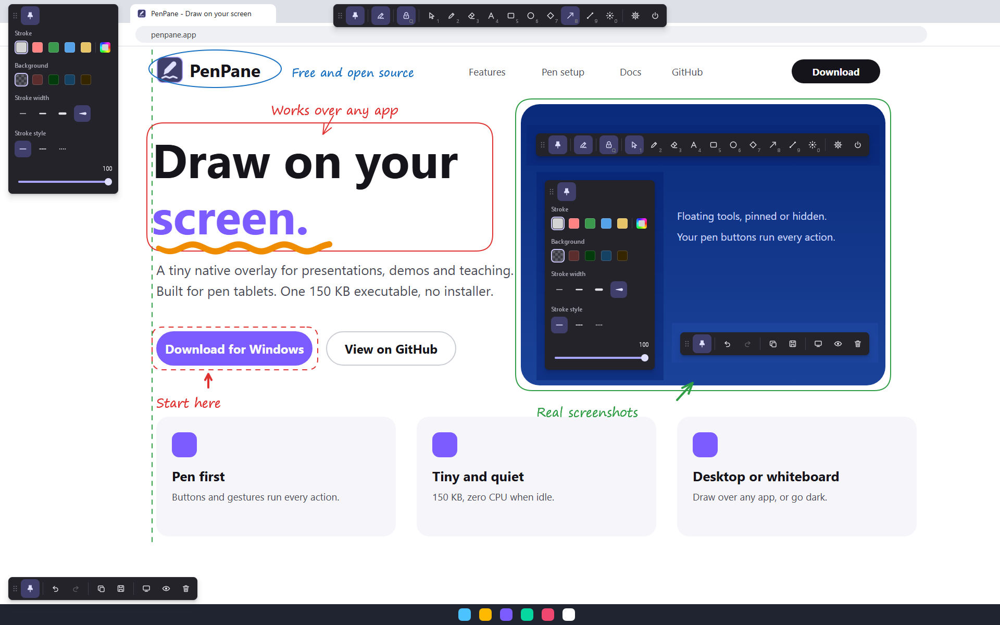
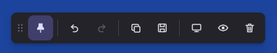
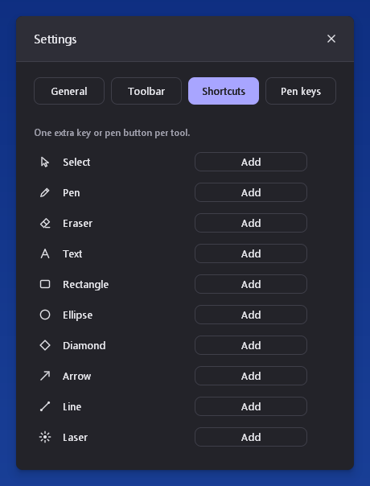

# PenPane

[](https://github.com/AlexDeveloperUwU/PenPane/actions/workflows/ci.yml)
[](https://github.com/AlexDeveloperUwU/PenPane/releases/latest)
[](LICENSE)


PenPane is a small native screen-annotation overlay for Windows 10 and 11. Draw over whatever is on screen for presentations, demos and teaching, or switch to a dark whiteboard. It is built for pen tablets: the buttons of the pen can run every action, and the drawing feel follows Excalidraw.

It is one executable of about 150 KB, written in C11 against the Win32 API. There is no runtime and no UI toolkit (the installer is optional), and when it is idle it uses no CPU.



| | |
|---|---|
|  |  |
|  |  |

## Quick start

1. From the Releases page of the repository, download either `PenPane-Setup-<version>.exe` (installer) or `PenPane.exe` (portable), plus its `.sha256` file, and check it: `(Get-FileHash <file>).Hash` must match the contents of the checksum file.
2. Run the installer (a short wizard; no administrator rights needed; it installs to `%LOCALAPPDATA%\Programs\PenPane` by default, adds a Start menu shortcut and an entry in Settings > Apps, and can add a desktop shortcut and start with Windows; `/S` installs silently and `/D=<folder>` picks the folder), or run the portable `PenPane.exe` from a folder you can write to, because it keeps `PenPane.ini` next to the executable. PenPane lives in the notification area and shows a small toolbar handle.
3. Click the toolbar handle and then its drawing button to turn drawing on or off. Starting the program a second time does the same. Right-click the tray icon for modes, screens, remapping, copying as PNG, starting with Windows and quitting.
4. `Ctrl+Alt+Shift+Esc` always quits. If another program owns that combination, PenPane falls back to `Ctrl+Alt+Shift+F12` and tells you.

The program starts on the select tool, so nothing is drawn until you pick a drawing tool.

| Tool | Key |
|---|---|
| Selection | V |
| Rectangle | R |
| Ellipse | O |
| Diamond | D |
| Arrow | A |
| Line | L |
| Pen | P or X |
| Laser | K |
| Text | T |
| Eraser | E |
| Tool by place in the toolbar | 1 to 9, 0 for the tenth |
| Tool lock | Q |
| Undo, redo | Ctrl+Z, Ctrl+Y or Ctrl+Shift+Z |

The tool lock keeps the current tool after each stroke. It is on by default; with it off, PenPane returns to the select tool after every stroke. More in [docs/usage.md](docs/usage.md).

## Features

**Drawing**
- Selection (move, resize, delete), rectangle, ellipse, diamond, arrow (one head or two), line, pen, laser pointer, text and eraser.
- Stroke and background colors, three widths plus pen pressure, solid, dashed and dotted styles, opacity, and unlimited undo and redo.
- Colors: five presets, a color picker with a hex field, an optional pastel row, and your own colors from the configuration file.
- Real pen pressure when the tablet reports it; otherwise the stroke width follows speed, using the model measured from Excalidraw.
- The laser pointer leaves nothing behind: its trail fades tail first, however short the stroke.
- Copy the drawing to the clipboard or save it as PNG, with transparency in desktop mode.

**Modes**
- Desktop mode draws on a transparent layer over live content. Whiteboard mode is an opaque dark canvas. Each keeps its own drawing and history.
- With drawing off, the annotations stay visible while mouse, touch and pen input reach the applications below.
- An eye button hides every drawing without deleting it. The trash button asks before clearing.

**Tools and panels**
- The toolbar, the properties panel and the undo and redo panel are separate windows. They open on click, fold back into a handle when you leave them, and can be pinned open.
- Reorder or hide tools in the settings window; the number keys follow the order.
- Choose the screen you draw on and the screen that holds the tools. The tools are excluded from screen capture by default, so an audience watching a shared screen does not see them.

**Pen buttons**
- Bind any action to a key or mouse button as a single, double or long press. Learn mode lets you press the button instead of typing its name.
- Give each tool one extra shortcut in the settings window; the built-in keys stay.
- A "Pen keys" helper types F13 to F16 into a tablet driver's key box, for drivers that cannot record them from the keyboard.

## Pen tablet setup

PenPane does not talk to tablet drivers. It reacts to keys and mouse buttons, so any pen with buttons works.

1. In the driver of your tablet, map the pen buttons to rarely used keys, for example `F13` and `F14`. If the driver's key box cannot record them because your keyboard has no such keys, open **Settings → Pen keys**, turn drawing off, click the key box in the driver, then click **F13** in PenPane. PenPane types it there for you.
2. Out of the box `F13` single press is undo, `F13` double press toggles drawing, `F14` single press selects the next tool, `F14` double press toggles desktop and whiteboard, and `F14` long press clears.
3. To change a binding, use **Settings → Shortcuts** for the tools, or **Remap buttons** in the tray menu for any action. Pick the action and press the button the way you want to use it (single, double or long). If you cannot press the key, click one of the F13 to F18 buttons shown above the list.

Details and the binding syntax are in [docs/configuration.md](docs/configuration.md).

## Configuration

Settings live in a plain-text `PenPane.ini` next to the executable, and most of them are also in the settings window. Every key is optional. The file can be edited by hand and reloaded from the tray menu. See [docs/configuration.md](docs/configuration.md) for every key.

## When something does not work

Turn on **Write a debug log** in the settings (or set `debug_log = true` in `PenPane.ini`). PenPane then writes `PenPane.log` next to the executable: start-up, configuration warnings, mode changes, window failures, display and lock events, tray notices and crashes, one short line each, never pointer movement. The file is capped at 1 MB (the older file is kept as `PenPane.log.1`). It costs nothing while off. Attach it to a bug report; it contains no drawings and no text you typed.

## Footprint

Measured on Windows 11 with the real executable (see [docs/measurements.md](docs/measurements.md)):

| Quantity | Value |
|---|---|
| Idle CPU, every state, over 60 s | 0 ms |
| Working set, hidden or drawing off | 0.2 to 0.3 MB |
| Working set while drawing on a 2560x1376 screen | about 16 MB (the drawing surface is 13.8 MB of it) |
| Process start to first visible window | 47.5 ms median |
| Pointer event, handler to present | 0.25 ms on average |

## Limitations

- Windows 10 version 2004 or later is needed for the capture exclusion of the tool panels (`WDA_EXCLUDEFROMCAPTURE`); on older versions they are visible in recordings.
- Programs running as administrator, and the secure desktop used by UAC prompts, are protected from normal processes: pen button bindings and mouse triggers may not reach PenPane while such a window has the focus, and it may not be able to draw over them. Run PenPane elevated only if you need this. The same applies to the Pen keys helper when the tablet driver runs elevated.
- Applications in exclusive full-screen mode (some games and video players) cover every overlay. Borderless full-screen windows work.
- Real pen pressure and multi-monitor setups are not covered by the automated tests; they were not verified on real tablet hardware or on more than one display by the author.
- The only export is a PNG, to the clipboard or to a file. There is no light theme, zoom, pan, image support or collaboration.

## Building from source

You need only the llvm-mingw toolchain, which one script installs after verifying its checksum:

```powershell
powershell -NoProfile -ExecutionPolicy Bypass -File scripts\setup-toolchain.ps1
powershell -NoProfile -ExecutionPolicy Bypass -File scripts\build.ps1
powershell -NoProfile -ExecutionPolicy Bypass -File scripts\test.ps1
```

The result is `build\PenPane.exe`. Details, measuring and API documentation are in [docs/building.md](docs/building.md).

## Documentation and contributing

- Start with [docs/README.md](docs/README.md). Decisions are recorded one per file in [docs/notes](docs/notes/index.md).
- Read [CONTRIBUTING.md](CONTRIBUTING.md) first, and follow the [code of conduct](CODE_OF_CONDUCT.md).
- Report vulnerabilities as described in [SECURITY.md](SECURITY.md).

## Acknowledgements

- [Excalidraw](https://github.com/excalidraw/excalidraw) (MIT) is the model for the look, sizes, shortcuts and drawing behaviour. The measured values are listed in [docs/excalidraw-reference.md](docs/excalidraw-reference.md).
- [perfect-freehand](https://github.com/steveruizok/perfect-freehand) (MIT, by Steve Ruiz) is the stroke algorithm behind the pen's width and smoothing, as described in [note 0040](docs/notes/0040-pen-width-model-follows-measured-perfect-freehand.md).
- [OpenBoard](https://openboard.ch) (GPL-3.0-only, by the Geneva education department) gave the idea of desktop mode: a transparent layer over the screen that you can draw on and interact with.

PenPane reuses only the constants and formulas of Excalidraw and perfect-freehand, and only the idea from OpenBoard. It does not use their code or technology.

## About this project

<a href="https://github.com/AlexDeveloperUwU#ai-usage"></a>

This project was fully generated with AI: I gave the orders and prompts, and I reviewed the result.

## License

PenPane is free software: you can redistribute it and modify it under the terms of the GNU General Public License as published by the Free Software Foundation, either version 3 of the License, or (at your option) any later version. It is distributed in the hope that it will be useful, but without any warranty. See [LICENSE](LICENSE) and [note 0093](docs/notes/0093-gpl-3-or-later-licence.md). Contributions are accepted under GPL-3.0-or-later.
